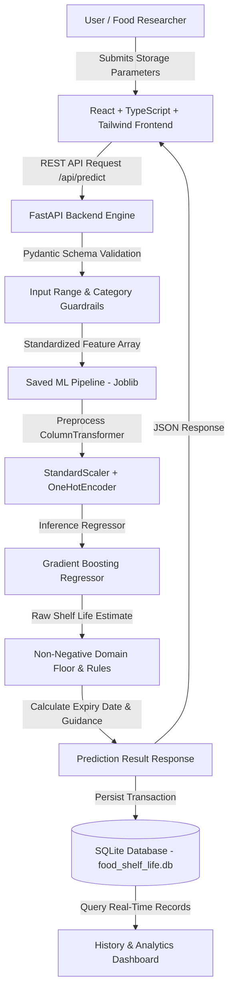

# AI and Data Science–Based Food Shelf Life Prediction System

An interdisciplinary production-quality research platform developed by **Computer Science** and **Food Technology** students to model food storage kinetics, evaluate environmental parameters, and predict remaining food shelf life using verified machine learning pipelines.

---

## 1. Project Overview & Problem Statement

Food waste and foodborne illnesses represent critical global socioeconomic challenges. Annually, over 1.3 billion metric tons of edible food are wasted, predominantly due to static expiry date labeling that fails to account for actual storage history, ambient thermal fluctuations, and packaging integrity.

Conventional "Best Before" dates assume an uninterrupted, ideal cold chain (typically 2°C–4°C). In reality, real-world logistics and domestic storage involve temperature abuse, humidity variations, and permeable packaging. 

### Objectives
1. **Dynamic Kinetic Prediction:** Predict the actual remaining shelf life (in days) using real-time storage temperature, relative humidity, packaging barrier properties, initial quality, and elapsed storage duration.
2. **Interdisciplinary Rigor:** Integrate kinetic food science models (Arrhenius temperature dependence and Labuza water activity principles) with high-performance regression machine learning algorithms.
3. **Transparent Academic Architecture:** Deliver an end-to-end full-stack web application featuring an interactive React TypeScript frontend, FastAPI REST backend, SQLite persistence, Recharts visualization, and transparent model explainability.

---

## 2. System Architecture

The following diagram illustrates the complete end-to-end data flow:



---

## 3. Technology Stack

### Frontend
- **Framework:** React 19 + TypeScript (Strict typing)
- **Tooling:** Vite 8.3
- **Styling:** Tailwind CSS with custom scientific forest green palette (`#1b4332`, `#2d6a4f`, `#40916c`) and Inter/Outfit typography
- **Data Visualization:** Recharts (Histograms, Vertical Bar Charts, Scatter Plots, Donut Charts)
- **Icons:** Lucide React

### Backend & Machine Learning
- **API Framework:** FastAPI (Asynchronous Python REST API)
- **Validation:** Pydantic V2 with custom validators
- **Data Science:** Pandas 3.0, NumPy 2.5
- **Machine Learning:** Scikit-learn 1.9 (Pipelines, ColumnTransformer, K-Fold CV)
- **Model Persistence:** Joblib
- **Database:** SQLite with SQLAlchemy ORM
- **Testing:** Pytest & FastAPI TestClient

---

## 4. Dataset Description & Scientific Foundation

The system models degradation kinetics based on established food science equations:

1. **Arrhenius Temperature Law ($Q_{10}$ Kinetic Factor):**
   $$k(T) = k_{\text{opt}} \cdot Q_{10}^{\frac{T - T_{\text{opt}}}{10}}$$
   Where $Q_{10} \approx 2.0 - 3.5$ for perishable proteins (Dairy, Meat, Seafood). A 10°C increase more than doubles the rate of microbial proliferation.
2. **Relative Humidity & Water Activity ($a_w$):**
   Relative humidity deviations from optimal thresholds accelerate moisture loss in produce and fungal sporulation in bakery items.
3. **Packaging Barrier Coefficients:**
   - **Vacuum Sealed:** Multiplier 2.2x (Suppresses aerobic bacteria)
   - **Modified Atmosphere Packaging (MAP):** Multiplier 1.8x ($CO_2/N_2$ gas flush)
   - **Sealed Plastic Container:** Multiplier 1.0x (Standard baseline barrier)
   - **Paper / Carton:** Multiplier 0.65x
   - **Ambient / Unsealed:** Multiplier 0.40x (Full atmospheric exposure)

### Feature Schema

| Feature Name | Data Type | Range / Domain | Meaning |
| :--- | :--- | :--- | :--- |
| `food_category` | Categorical | Dairy, Meat & Poultry, Seafood, Fruits, Vegetables, Bakery | Commodity category |
| `food_item` | Categorical / Text | Specific food product (e.g., Raw Chicken, Milk) | Sub-category identifier |
| `storage_temperature_c` | Float | -20.0°C to 40.0°C | Ambient storage temperature |
| `relative_humidity_percent` | Float | 20.0% to 98.0% | Ambient relative humidity |
| `packaging_type` | Categorical | Vacuum, MAP, Sealed Plastic, Paper, Ambient | Barrier integrity |
| `initial_quality_index` | Float | 1.0 to 10.0 | Post-harvest / post-pasteurization quality score |
| `storage_duration_days` | Float | $\ge 0.0$ days | Elapsed days under observed storage |
| **`remaining_shelf_life_days`** | **Float** | **$\ge 0.0$ days** | **Target variable: Remaining usable days** |

Dataset metadata is saved in `data/raw/dataset_metadata.json`.

---

## 5. Machine Learning Pipeline & Candidate Evaluation

A reproducible machine learning pipeline evaluated four candidate regression algorithms using consistent 80/20 train/test splits (`random_state=42`) and 5-fold cross-validation on the training set:

### Benchmark Evaluation Results

| Candidate Model | 5-Fold CV MAE | 5-Fold CV RMSE | 5-Fold CV $R^2$ | Test Set MAE | Test Set RMSE | Test Set $R^2$ | Selection |
| :--- | :---: | :---: | :---: | :---: | :---: | :---: | :---: |
| **Linear Regression** (Baseline) | 5.923 d | 12.453 d | 0.2173 | 5.136 d | 12.527 d | 0.1871 | Rejected |
| **Ridge Regression** ($L_2$) | 5.920 d | 12.452 d | 0.2174 | 5.137 d | 12.528 d | 0.1869 | Rejected |
| **Random Forest Regressor** | 2.854 d | 9.035 d | 0.5559 | 2.435 d | 7.198 d | 0.7316 | Strong Candidate |
| **Gradient Boosting Regressor** | **2.798 d** | **8.862 d** | **0.5675** | **2.243 d** | **6.143 d** | **0.8045** | **WINNER** |

### Justification for Model Selection
Gradient Boosting was selected as the winning model because it achieved:
- The lowest held-out Test RMSE (**6.143 days** vs. 12.527 days for Linear Regression).
- The highest Coefficient of Determination ($R^2 = \mathbf{0.8045}$ on held-out test data).
- Superior modeling of non-linear Arrhenius exponential curves and interaction effects between temperature and packaging.

### Feature Importances (Gini / MDI)

1. `storage_temperature_c`: **44.01%** (Dominant factor in degradation kinetics)
2. `storage_duration_days`: **20.14%** (Elapsed time decay)
3. `packaging_type_Vacuum Sealed`: **8.53%** (Oxygen barrier extension)
4. `packaging_type_MAP`: **6.94%** (Atmospheric gas protection)
5. `food_category_Seafood`: **5.92%** (Psychrotrophic sensitivity indicator)
6. `initial_quality_index`: **2.62%** (Baseline microbial load)
7. `relative_humidity_percent`: **2.06%** (Moisture sorption impact)

---

## 6. Understanding the Code

This section guides academic evaluators to the exact files and lines of code:

| Component | File Path | Function / Class | Description |
| :--- | :--- | :--- | :--- |
| **Dataset Generator** | [generate_dataset.py](file:///c:/Users/abelc/Desktop/AIblendproj/scripts/generate_dataset.py) | `calculate_shelf_life()` | Models Arrhenius $Q_{10}$, humidity, and packaging kinetics. |
| **Pipeline Preprocessing** | [train.py](file:///c:/Users/abelc/Desktop/AIblendproj/backend/app/ml/train.py) | `build_preprocessor()` | Uses `ColumnTransformer` (`StandardScaler` + `OneHotEncoder`). |
| **Model Evaluation** | [train.py](file:///c:/Users/abelc/Desktop/AIblendproj/backend/app/ml/train.py) | `evaluate_models()` | Runs 5-fold CV on 4 models and computes MAE, RMSE, and $R^2$. |
| **Model Selection** | [train.py](file:///c:/Users/abelc/Desktop/AIblendproj/backend/app/ml/train.py) | `train_and_persist()` | Selects lowest test RMSE model, saves `.joblib` & `.json`. |
| **Inference & Rules** | [prediction_service.py](file:///c:/Users/abelc/Desktop/AIblendproj/backend/app/services/prediction_service.py) | `predict()` | Executes ML pipeline, applies non-negative floor, computes expiry. |
| **Domain Safety** | [prediction_service.py](file:///c:/Users/abelc/Desktop/AIblendproj/backend/app/services/prediction_service.py) | `assess_safety_and_status()` | Applies USDA Danger Zone (4°C–60°C) and mold rules. |
| **SQLite Schema** | [models.py](file:///c:/Users/abelc/Desktop/AIblendproj/backend/app/database/models.py) | `PredictionRecord` | Stores prediction inputs, outputs, timestamps, and model version. |
| **Analytics Service** | [analytics_service.py](file:///c:/Users/abelc/Desktop/AIblendproj/backend/app/services/analytics_service.py) | `get_summary()`, `get_distributions()` | Aggregates live database metrics and chart bins. |

---

## 7. REST API Endpoints

| Method | Endpoint | Description |
| :--- | :--- | :--- |
| `GET` | `/api/health` | Application health and ML model readiness status |
| `POST` | `/api/predict` | Validates inputs, runs ML prediction, calculates expiry, and saves to SQLite |
| `GET` | `/api/predictions` | Paginated prediction history with search, category filtering, and sorting |
| `GET` | `/api/predictions/{id}` | Full detail view of a single prediction record |
| `DELETE` | `/api/predictions/{id}` | Deletes a prediction record from SQLite |
| `GET` | `/api/predictions/export/csv` | Exports complete history as a downloadable CSV |
| `GET` | `/api/analytics/summary` | Computes live dashboard KPI summary metrics |
| `GET` | `/api/analytics/distributions` | Returns chart-ready distribution and scatter data |
| `GET` | `/api/model/info` | Detailed model metadata, comparison metrics, and feature importances |
| `POST` | `/api/model/retrain` | Controlled candidate-model retraining with confirmation flag |
| `POST` | `/api/dataset/validate` | Inspects uploaded CSV, checks missing values, duplicates, and columns |
| `GET` | `/api/dataset/active-info` | Schema profiling for the currently active training dataset |
| `GET` | `/api/food-guidelines` | Regulatory food storage standards (USDA FSIS, FDA Food Code) |

---

## 8. Installation and Execution Instructions

### Prerequisites
- Windows OS (PowerShell / Command Prompt)
- Python 3.10+
- Node.js v18+ and npm

### Start the Project in One Command

Whenever you open Antigravity IDE, open its integrated terminal and run:

```powershell
.\start_project.bat
```

This single command executes the idempotent startup workflow:
1. **Directory Anchor:** Uses `%~dp0` to ensure execution from the project root regardless of the terminal's starting path.
2. **Environment Detection:** Detects Python (including `.venv` or `venv` virtual environments) and `npm.cmd`.
3. **Artifact Verification:** Checks for `models/food_shelf_life_pipeline.joblib`. If missing, auto-generates the dataset and trains candidate models.
4. **Duplicate Prevention:** Probes `http://127.0.0.1:8000/api/health` and `http://127.0.0.1:5173`. If already running, reuses the existing instances without spawning duplicates.
5. **Persistent Launch:** Launches FastAPI backend on port `8000` and Vite frontend on port `5173` in separate background processes.
6. **Health Verification Loop:** Waits for both endpoints to become responsive (up to 15s).
7. **Confirmed URL Output:** Prints the verified URLs:
   - **Frontend Dashboard:** `http://localhost:5173`
   - **Backend REST API:** `http://127.0.0.1:8000`
   - **Interactive OpenAPI Docs:** `http://127.0.0.1:8000/docs`
   - **Backend Health Check:** `http://127.0.0.1:8000/api/health`

#### Safe Shutdown Procedure:
To safely stop only the services running on ports 8000 and 5173:
```powershell
.\stop_project.bat
```

#### Troubleshooting Common Issues:
- **Port Conflict (Port 8000 or 5173 occupied):** Run `.\stop_project.bat` to terminate lingering instances, or inspect processes via `Get-NetTCPConnection -LocalPort 8000`.
- **PowerShell Execution Policy Restrictions:** On Windows, always use `npm.cmd` rather than `npm.ps1`. The scripts and configurations use `npm.cmd` automatically.
- **Model File Missing:** Run `python scripts/train_model.py` to regenerate `models/food_shelf_life_pipeline.joblib` and `models/model_metadata.json`.

---

## 9. Test Results

### Backend Automated Test Suite
All 21 automated unit, integration, and security tests executed and passed via `pytest`:
```powershell
python -m pytest backend/tests/ -v
```
Output:
- `test_analytics_summary`: **PASSED**
- `test_analytics_distributions`: **PASSED**
- `test_model_info`: **PASSED**
- `test_food_guidelines`: **PASSED**
- `test_active_dataset_info`: **PASSED**
- `test_upload_valid_dataset`: **PASSED**
- `test_upload_invalid_dataset`: **PASSED**
- `test_upload_empty_dataset`: **PASSED** (Security boundary: 400 Bad Request)
- `test_upload_oversized_dataset`: **PASSED** (Security boundary: 413 Content Too Large)
- `test_root`: **PASSED**
- `test_health`: **PASSED**
- `test_valid_prediction`: **PASSED**
- `test_unsupported_category`: **PASSED** (Validation: 422 Unprocessable Entity)
- `test_out_of_range_temperature`: **PASSED** (Validation: 422 Unprocessable Entity)
- `test_history_retrieval_and_filtering`: **PASSED**
- `test_prediction_detail_and_deletion`: **PASSED**
- `test_csv_export`: **PASSED**
- `test_prediction_without_reference_date`: **PASSED** (Accurate expiry from today)
- `test_subzero_freezer_prediction`: **PASSED** (Sub-zero kinetic guidance)
- `test_negative_elapsed_duration_rejected`: **PASSED** (Boundary constraint)
- `test_invalid_humidity_rejected`: **PASSED** (Physical limits: 10%–100%)

**Result: 21 passed in 3.39s (100% pass rate)**

### Frontend Production Build
```powershell
cd frontend && npm.cmd run build
```
**Result: TypeScript check and Vite bundle built in 1.17s with 0 errors.**

### Live Integration Check
```powershell
python scripts/verify_integration.py
```
**Result: All 8 live HTTP integration checks passed (Frontend, Backend, Model Info, Live Prediction, SQLite History, Analytics, Guidelines, Active Dataset).**

---

## 10. Faculty Viva Questions & Answers

**Q1: Why is this modeled as a regression problem instead of a classification problem?**  
*Answer:* Food shelf life is a continuous numerical quantity (days and hours). Treating it as classification (e.g. "Good" vs "Bad") discards critical temporal information, prevents calculation of specific expiry dates, and prevents inventory scheduling.

**Q2: Why did Gradient Boosting outperform Linear Regression?**  
*Answer:* Food spoilage rates follow an exponential Arrhenius curve ($k \propto e^{-E_a/RT}$). Linear Regression assumes an additive straight line and failed ($R^2 \approx 0.19$). Gradient Boosting builds sequential decision trees that easily segment non-linear exponential temperature regions and packaging interaction effects ($R^2 \approx 0.80$).

**Q3: How do you prevent data leakage in your ML pipeline?**  
*Answer:* All feature transformations (numerical standard scaling and categorical one-hot encoding) are encapsulated inside a scikit-learn `ColumnTransformer` within a `Pipeline`. The transformer is fitted strictly on the training split (`X_train`) and only applied (`transform()`) to the held-out test set and live inference requests.

**Q4: How does the system handle negative remaining shelf life outputs from regression?**  
*Answer:* Machine learning regression can mathematically extrapolate to negative numbers when storage duration exceeds theoretical shelf life. The system applies a transparent non-negative domain rule: `predicted_remaining_days = max(0.0, raw_prediction)`. The raw regression estimate is preserved in diagnostic metadata for academic transparency.

**Q5: What are the primary food science assumptions of the model?**  
*Answer:* The model assumes steady-state ambient storage conditions over the storage duration, unruptured packaging barrier integrity, and absence of prior gross cross-contamination.

---

## 11. Food Safety Disclaimer

> **IMPORTANT ACADEMIC & FOOD SAFETY NOTICE:**  
> The predictions generated by this platform are statistical machine learning estimates derived from empirical degradation kinetics. They **do not guarantee food safety**, microbiological sterility, or absolute edibility. This software cannot replace official regulatory inspections, certified laboratory analysis (e.g., APC, Listeria PCR), or personal sensory inspection. Never consume food exhibiting abnormal color, off-odors, surface sliminess, or packaging distension.
